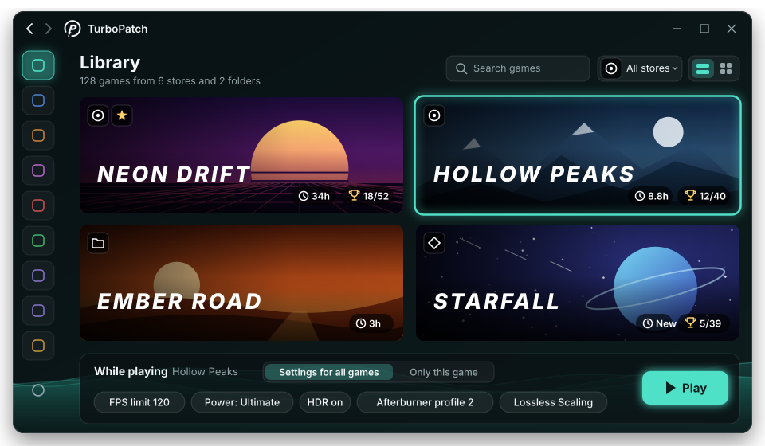
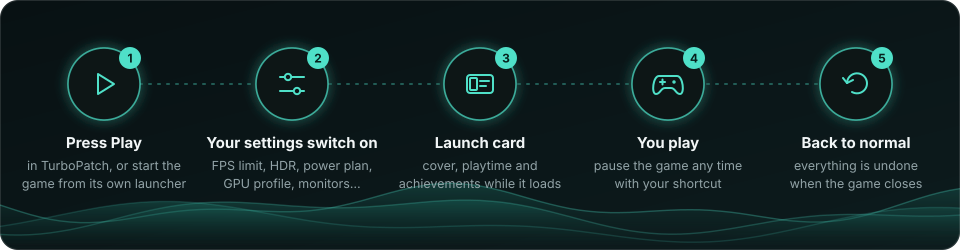
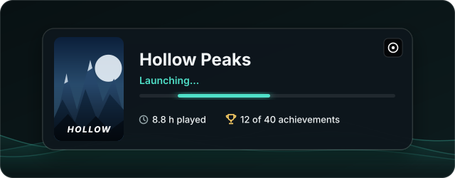
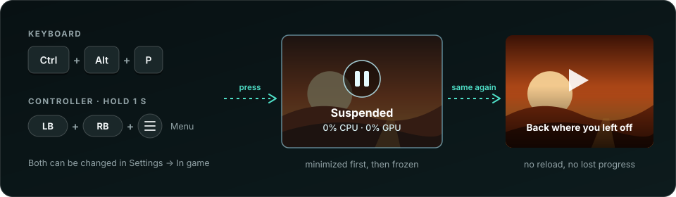
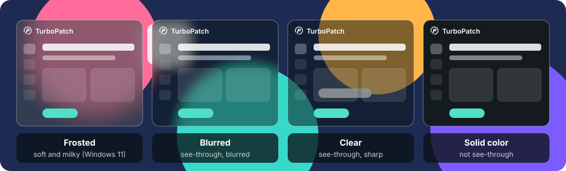
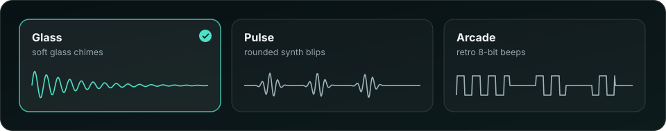

  

  

  
  
  
  
  

  <a href="#-what-it-does">What it does</a> ·
  <a href="#-download-and-start">Download</a> ·
  <a href="#-a-tour">Tour</a> ·
  <a href="#-your-first-ten-minutes">First steps</a> ·
  <a href="#-faq">FAQ</a> ·
  <a href="#-credits">Credits</a>

---

**TurboPatch** puts everything you use to tweak single-player PC games into one calm, good-looking
app. It finds every game you own, installs the community's best mods for each one (with a backup of
everything it touches), and switches your favorite settings on while you play: frame limit, HDR,
power plan, graphics card profile, monitors. When the game closes, your PC goes back to exactly how
it was.

It doesn't bundle or repackage anyone's work. Mods come straight from their official sources, and
the tools that touch your hardware (MSI Afterburner, RTSS, Fan Control and others) stay the
originals: TurboPatch links to them and drives them for you.

> [!WARNING]
> **Single-player games only.** ReShade and its add-ons work by loading into the game, and online
> games with anti-cheat can treat that as cheating and ban the account. TurboPatch spots common
> anti-cheat and asks before installing anything into those games.

## ✨ What it does

| Feature | What you get |
|---|---|
| 🎮 **One library for every store** | Steam, Epic, GOG, EA app, Ubisoft Connect, Battle.net, Rockstar, the Xbox app / Game Pass, and your own folders (DRM-free, portable games, emulators). |
| 🧩 **Mods in a click** | ReShade, RenoDX HDR mods, ReLimiter, BFI Presenter, DLSS upgrades and DLSS 5 neural rendering, plus one shared shader library for all games. Every replaced file is backed up. |
| ⚡ **Settings that switch on when you play** | FPS limit, HDR, power plan, Afterburner profile, brightness, monitors, Lossless Scaling, controller hiding. Off again when you stop. |
| ⏸️ **Pause any game** | Freeze a single-player game with a keyboard shortcut or a controller button combo, and pick up where you left off. |
| 🏆 **Achievements and playtime** | See your Steam achievements and how long you've played, right on the game. |
| 🧊 **No more shader stutter** | Compile shaders before you play (with SCSKiller), for the games known to stutter. |
| 🖥️ **Monitors and HDR** | Turn screens off and on, toggle HDR, set brightness, save layouts. Changes undo themselves unless you confirm. |
| 🎨 **Made to look good** | Frosted-glass themes, animated backgrounds that pause while you play, three sets of sound effects, 11 languages. |

## 📥 Download and start

1. Go to **[Releases](../../releases/latest)** and download `TurboPatch-<version>-win-x64.zip`.
2. **Unzip it** to a folder you like, for example `C:\Games\TurboPatch`. Don't run it from inside the zip.
3. Double-click **`TurboPatch.exe`**. Nothing else needs installing; .NET is included.
4. Windows asks for **administrator rights**. Say yes: TurboPatch needs them to change game folders,
   RTSS and MSI Afterburner. Your games still start as your normal user.

> [!NOTE]
> **"Windows protected your PC"?** TurboPatch isn't signed with a paid certificate, so SmartScreen
> warns the first time. Click **More info → Run anyway**. Want to be sure the download is genuine?
> Compare its checksum with the `.sha256.txt` on the release page:
> `Get-FileHash .\TurboPatch-<version>-win-x64.zip -Algorithm SHA256`

**You need:** Windows 10 or 11 (64-bit). An NVIDIA RTX card for DLSS features; everything else works
on any GPU.

## 🗺️ A tour

### Your whole library, in one place

TurboPatch reads every launcher on your PC and lists your games together. Show them as a **list**,
a grid of **covers**, or wide **banners** with each game's logo on top. Covers, banners and logos
download automatically (from Steam, or from SteamGridDB if you add a free key), and you can pick
your own for any game.

- **Filter and sort** by store, favorites, recently played, collections or hidden games, or just search.
- **Playtime** and *last played* are tracked for every game.
- **Achievements** for Steam games, read from Steam's files on your PC. Connect your Steam account
  (optional) for exact numbers.
- **Save folders:** TurboPatch knows where most games keep their saves and can back them up in one click.
- Right-click a game (or select several) to play, rename, customize, favorite, collect, reset or remove.

### Settings that turn on when you play

Pick what should change *while you play*:

| Setting | What happens |
|---|---|
| Frame limit | RTSS caps the FPS |
| Graphics card | an MSI Afterburner profile (undervolt, overclock…) is applied |
| Power plan | for example *Ultimate Performance* |
| HDR | Windows HDR turns on |
| Monitors | extra screens switch off; brightness changes |
| Lossless Scaling | starts with the game |
| Controllers | HidHide hides the real pad (no double input) |
| Other programs | anything else you want started |

Every game shares one set, **Settings for all games**, so you set things up once. Want something
different for one game? Switch it to **Only this game**. Both can be reset at any time.

Press **Play** and it all happens before the game starts. Started the game from Steam or another
launcher instead? TurboPatch notices and does the same. When the game closes, everything is put back.

### A launch card while the game loads

A small card shows the game, your playtime and achievements while it starts. It never steals focus
and disappears once the game is up. You can turn it off in *Settings → In game*.

### Pause any game, for real

Need to step away mid-cutscene or in a game without a pause button? **Suspend** freezes the game
completely: it uses no CPU or GPU until you wake it, right where you left off.

- **Keyboard:** `Ctrl` + `Alt` + `P` (change it to anything you like).
- **Controller:** hold `LB` + `RB` + `Menu` for one second (pick your own buttons and hold time).
- Also from the game's page in the Library or the tray icon.

It's built not to crash games: the game is minimized first so it can pause itself, only the game's
own programs are frozen, games with anti-cheat are never touched, and anything still frozen is woken
up when TurboPatch closes. Suspended time doesn't count as playtime.

### Mods, installed properly

Open the **Mods** page, pick a game, and install:

| Mod | What it is |
|---|---|
| **ReShade** | post-processing for any game; TurboPatch picks the right version and file name for the game |
| **RenoDX** | proper HDR for hundreds of games, matched to your game automatically |
| **ReLimiter** | a low-latency frame limiter inside ReShade |
| **BFI Presenter** | black frame insertion for sharper motion |
| **DLSS upgrade** | swaps the game's DLSS files for NVIDIA's newest, in one click |
| **DLSS 5** | neural rendering through community add-ons, also for games without DLSS |
| **Shaders** | popular ReShade shader collections, downloaded once and shared by every game |

Anything replaced is kept as a backup and can be restored. TurboPatch warns you about clashes, such
as two frame limiters at once, and **Settings → Updates** tells you when a mod or tool has a newer version.

### The same ReShade look in every game

Tired of ReShade's menu looking different in every game? Set colors, opacity, roundness, font,
font size and the FPS counter once, with a live preview, and TurboPatch keeps that look in every
game with ReShade. One click puts ReShade's own look back.

### Everything else

| Page | What you'll find |
|---|---|
| **Tools** | every program TurboPatch works with: installed or not, its version, and a link to the official download |
| **Shaders** | lists your DirectX 11/12 games and how badly each is known to stutter, then compiles their shaders ahead of time with SCSKiller (NVIDIA and AMD) |
| **Display** | monitors off/on, HDR per monitor, brightness per monitor, saved layouts; changes roll back after 15 seconds unless you keep them |
| **Input** | live view of your controllers, and the DS4Windows → HidHide → Steam Input → x360ce path to make any pad work |
| **Hardware** | PC summary, MSI Afterburner profiles, Fan Control, and the CPU tuning tool for your processor |
| **Performance** | live FPS and frame time, frame-limiting tips, Lossless Scaling, power plans |
| **Community** | ready-made settings for a game, matched to your GPU, with a preview of every change, a backup and one-click restore; share your own as presets |

Use the **back and forward arrows** at the top left (or your mouse's side buttons, or `Alt` + `←` / `→`)
to move between pages like in a browser.

### Looks and feels good

- **12 themes**, 6 dark and 6 light, or make your own: choose the glass, its color and opacity,
  a fine grain, the background effect (waves, aurora, embers, gradient or your own picture) and
  accent colors. Changes show instantly; themes can be exported and shared.
- The window keeps its look when it's in the background, and **animations stop while you play**,
  so TurboPatch costs your games nothing.
- **Sound effects** for clicks, switches and game events, in three sets, with volume and per-sound switches:

- **11 languages:** English, العربية, Türkçe, Русский, Deutsch, 日本語, 简体中文, Español, Svenska,
  Bahasa Indonesia and Tiếng Việt. Arabic turns the whole app right to left. Optionally, game titles
  can show in your language when the publisher made an official translation.
- Works with **touch and pen**, and stays sharp on **4K** and any display scale.

> [!NOTE]
> The pictures on this page are illustrations of TurboPatch's screens with made-up games.

## 🚀 Your first ten minutes

1. **Tools:** install what you want to use. **MSI Afterburner** and **RTSS** are the most useful.
2. In **MSI Afterburner**, save profiles in slots 1–5 (for example 1 = stock, 2 = undervolt, 3 = overclock).
3. **Mods:** pick a game, install **ReShade**, then add RenoDX, ReLimiter or BFI Presenter if you like.
   Tick some shader collections and download them.
4. **Library:** fill in *While playing* once for all games, save, then press **Play**.
5. **Shaders** (optional): install SCSKiller from the Tools page and compile the games that are ready.
6. **Settings → In game** (optional): choose your suspend shortcut and controller buttons, and turn on
   *Keep this look in every game* for ReShade.
7. Leave TurboPatch in the tray, so your settings also apply when you start games from elsewhere.

## 🛡️ Safe by design

- **Everything is undoable.** Replaced files are kept as `.tpbak` backups, community settings are
  backed up before they're applied, and monitor or HDR changes roll back on their own unless you confirm.
- **Nothing hidden.** No bundled programs, no tracking, nothing installed without you pressing a button.
- **Official sources only.** Mods download from their own websites and GitHub pages; tools link to
  their makers' download pages.
- **Light on your PC.** Animations and artwork downloads pause while a game runs, and the controller
  shortcut is only listened for while a game is running.

## ❓ FAQ

<b>Is it free?</b>

Yes, and it's not for sale. TurboPatch is a hobby project. The tools it works with belong to their
makers, and some of them (like Lossless Scaling) are paid apps you buy yourself.

<b>Can I get banned for using it?</b>

In single-player games, no. Online games with anti-cheat may ban accounts for ReShade and similar
mods, which is why TurboPatch detects anti-cheat, asks before installing, and never suspends those games.

<b>Why does it need administrator rights?</b>

Games under *Program Files*, RTSS profiles and MSI Afterburner can't be changed without them. Running
TurboPatch as administrator once means no prompt for every action. Games are still started as your
normal user. *Start with Windows* uses a scheduled task, so there's no prompt at sign-in either.

<b>My antivirus is suspicious. Is it safe?</b>

TurboPatch is unsigned, asks for administrator rights and installs DLLs into games (that's how ReShade
works), which some antivirus programs dislike. Download it only from this page's Releases, check the
checksum, and if you like, build it yourself from the source here.

<b>Achievements don't show for my game.</b>

Achievements are shown for Steam games only; other stores don't keep them in files TurboPatch can
read. Steam has the numbers once you've run the game through Steam. For exact numbers, add a Steam Web
API key in *Settings → Library*.

<b>Where are my settings kept?</b>

- `%AppData%\TurboPatch`: settings, themes, your library and while-playing settings
- `%LocalAppData%\TurboPatch`: downloads, artwork, save backups, shaders, logs
- In game folders: only what you install, plus `.tpbak` backups

*Settings → Backup* saves everything to one zip.

<b>How do I remove it?</b>

1. In *Settings → General*, turn off *Start with Windows* (if it's on). Remove mods from games on the
   Mods page if you want them back to stock.
2. Exit TurboPatch from the tray icon, then delete its folder and the two folders above.

<b>Does it work on Windows 10?</b>

Yes. Frosted glass needs Windows 11, so Windows 10 shows blurred glass instead; everything else is the same.

## ⚠️ Good to know

- EA app, Battle.net and Rockstar games are started through their exe (their launcher takes over).
  Xbox / Game Pass games can't take launch options, and their folders may not accept mods.
- Suspended online games lose their connection, and a few games stutter for a moment after waking.
- Brightness control needs DDC/CI switched on in your monitor's menu (most have it on).
- DLSS 5 add-ons are community projects; some files are shared only on their Discord servers.
- One game at a time gets automatic while-playing settings.

## 🌍 Help translate

Translations are plain JSON files in `src/TurboPatch.Core/Localization/Strings/`. Spotted an awkward
phrase in your language? Open an issue or a pull request; `python tools/l10n/check_translations.py`
checks every language for missing text and placeholders.

## 💚 Credits

TurboPatch stands on the work of many generous people. Thank you:

**Mods and add-ons:** [ReShade](https://reshade.me/) (crosire) ·
[RenoDX](https://github.com/clshortfuse/renodx) (clshortfuse and contributors) ·
[ReLimiter](https://github.com/RankFTW/ReLimiter) and [RHI](https://github.com/RankFTW/RHI) (RankFTW) ·
[BFI Presenter](https://github.com/artzox/BFI-Presenter) (artzox) ·
[DLSS5-Feeder](https://github.com/jlrouzies-fr/DLSS5-Feeder) (jlrouzies-fr) ·
[OptiScaler](https://github.com/optiscaler/OptiScaler) (cdozdil and contributors) ·
[LumeniteFX](https://github.com/umar-afzaal/LumeniteFX) (umar-afzaal) ·
[NVIDIA DLSS](https://github.com/NVIDIA/DLSS)

**Shaders:** [reshade-shaders](https://github.com/crosire/reshade-shaders) (crosire) ·
[ReShade HDR shaders](https://github.com/EndlesslyFlowering/ReShade_HDR_shaders) (EndlesslyFlowering) ·
[SweetFX](https://github.com/CeeJayDK/SweetFX) (CeeJayDK) ·
[prod80](https://github.com/prod80/prod80-ReShade-Repository) ·
[iMMERSE, qUINT](https://github.com/martymcmodding) (Marty McFly) ·
[AstrayFX](https://github.com/BlueSkyDefender/AstrayFX) (BlueSkyDefender) ·
[Fubax](https://github.com/Fubaxiusz/fubax-shaders) (Fubaxiusz)

**Tools:** [SCSKiller](https://github.com/BlueHeisenberg/SCSKiller) (BlueHeisenberg) ·
[RTSS](https://www.guru3d.com/download/rtss-rivatuner-statistics-server-download/) and
[MSI Afterburner](https://www.msi.com/Landing/afterburner/graphics-cards) (Unwinder, MSI) ·
[Lossless Scaling](https://store.steampowered.com/app/993090/) (THS) ·
[Fan Control](https://github.com/Rem0o/FanControl.Releases) (Rem0o) ·
[DS4Windows](https://github.com/schmaldeo/DS4Windows) (schmaldeo) ·
[HidHide](https://github.com/nefarius/HidHide) (Nefarius) ·
[x360ce](https://github.com/x360ce/x360ce) ·
[Monarch](https://github.com/Nuzair46/Monarch) (Nuzair46) ·
[ThrottleStop](https://www.techpowerup.com/download/techpowerup-throttlestop/) (unclewebb) ·
[Ryzen Master](https://www.amd.com/en/products/software/ryzen-master.html) (AMD) · Intel XTU

**Data and artwork:** [Ludusavi manifest](https://github.com/mtkennerly/ludusavi-manifest)
(mtkennerly, from PCGamingWiki) · [SteamGridDB](https://www.steamgriddb.com/) · [Steam](https://store.steampowered.com/)

Details are in [THIRD_PARTY_NOTICES.md](THIRD_PARTY_NOTICES.md). TurboPatch
isn't affiliated with or endorsed by any of them; names and logos belong to their owners.

## 📄 License

TurboPatch's own code is released under the [MIT License](LICENSE). The tools and mods it downloads
or links to keep their own licenses.

Made with care by <b>M0KX</b> for people who like their games just right.

