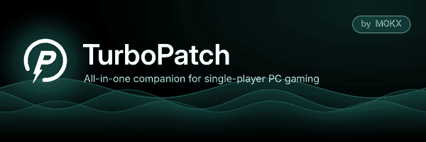
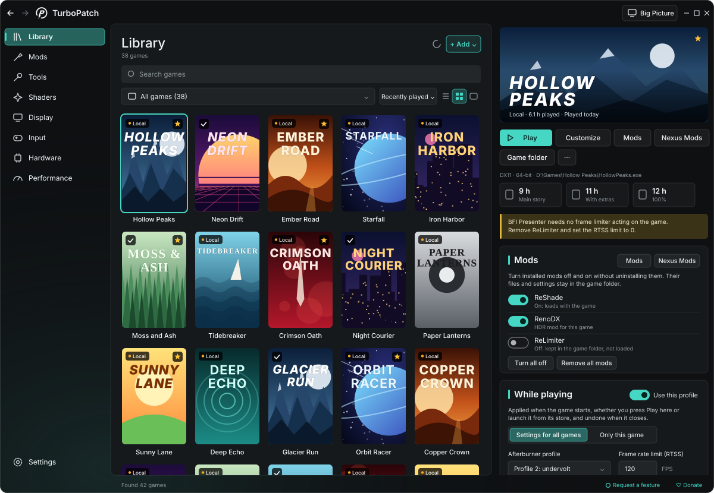
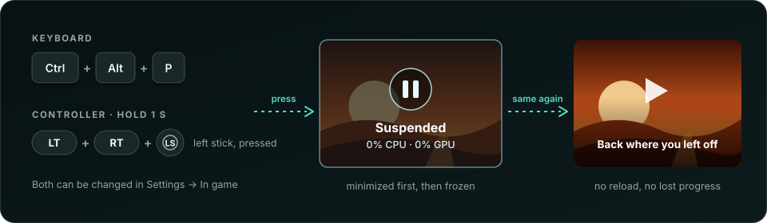
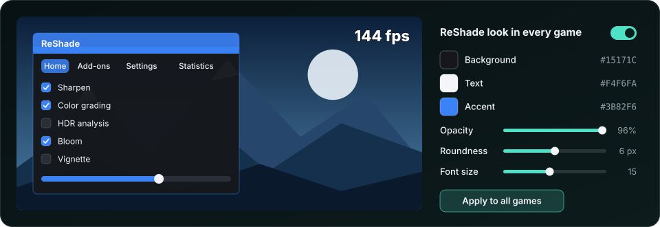
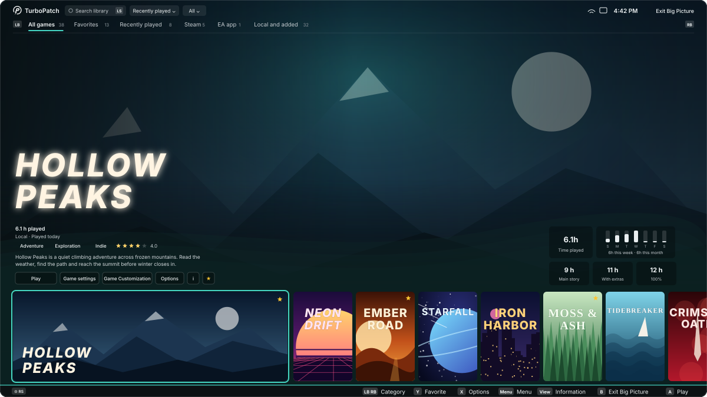
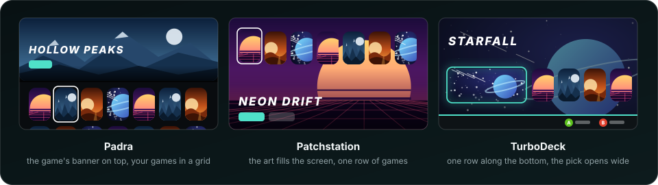
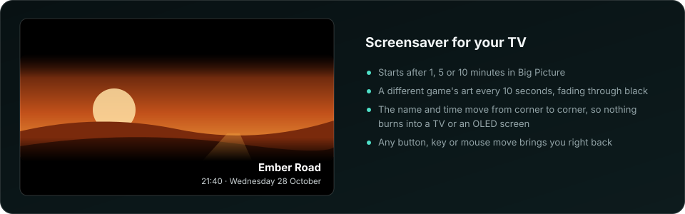
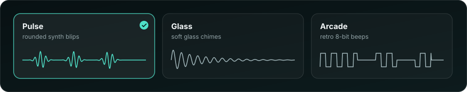

  

  
  &nbsp;
  

  
  
  
  
  
  

  <a href="#-what-it-does">What it does</a> ·
  <a href="#-download-and-install">Download</a> ·
  <a href="#-a-tour">Tour</a> ·
  <a href="#-big-picture-for-the-couch">Big Picture</a> ·
  <a href="#-your-first-ten-minutes">First steps</a> ·
  <a href="#-faq">FAQ</a> ·
  <a href="#-credits">Credits</a>

---

**TurboPatch** puts everything you use to tweak single-player PC games into one calm, good-looking
app. It finds every game you own, installs the community's best mods for each one (with a backup of
everything it touches), and switches your favorite settings on while you play: frame limit, HDR,
power plan, graphics card profile, monitors. When the game closes, your PC goes back to exactly how
it was. And when you'd rather sit on the couch, **Big Picture** turns your library into a
full-screen, controller-friendly launcher for the TV.

It doesn't bundle or repackage anyone's work. Mods come straight from their official sources, and
the tools that touch your hardware (MSI Afterburner, RTSS, Fan Control and others) stay the
originals: TurboPatch links to them and drives them for you.

> [!WARNING]
> **Single-player games only.** ReShade and its add-ons work by loading into the game, and online
> games with anti-cheat can treat that as cheating and ban the account. TurboPatch spots common
> anti-cheat and won't install into those games until you confirm you play them offline.

## ✨ What it does

| Feature | What you get |
|---|---|
| 🎮 **One library for every store** | Steam, Epic, GOG, EA app, Ubisoft Connect, Battle.net, Rockstar, the Xbox app / Game Pass, and your own folders (DRM-free, portable games, emulators). |
| 📺 **Big Picture** | Your library full screen on the TV, made for a controller, with three looks, music and a screensaver. |
| 🧩 **Mods in a click** | ReShade, RenoDX HDR mods, ReLimiter, BFI Presenter, DLSS upgrades and DLSS 5 neural rendering, plus one shared shader library (and your own shaders). Every replaced file is backed up. |
| ⚡ **Settings that switch on when you play** | FPS limit, HDR, power plan, Afterburner profile, brightness, monitors, Lossless Scaling, controller hiding. Off again when you stop. |
| ⏸️ **Pause any game** | Freeze a single-player game with a keyboard shortcut or a controller button combo, and pick up where you left off. |
| 🏆 **Everything about your games** | Playtime, Steam achievements, genres, age ratings, community star ratings and HowLongToBeat times. |
| 🧊 **No more shader stutter** | Compile shaders before you play (with SCSKiller), for the games known to stutter. |
| 🖥️ **Monitors and HDR** | Turn screens off and on, toggle HDR, set brightness, save layouts. Changes undo themselves unless you confirm. |
| 🎮 **Any controller** | Xbox, PlayStation, 8BitDo, GameSir and FlyDigi pads, with battery levels, no DS4Windows needed. |
| 🎨 **Made to look good** | Glass themes, animated backgrounds that pause while you play, three sets of sound effects, 11 languages. |
| 🔄 **Keeps itself up to date** | The installed app updates itself from this page, and tells you when your mods and tools have new versions. |

## 📥 Download and install

1. Go to **[Releases](https://github.com/M0KX-01/TurboPatch/releases/latest)** and download the **`.msi`** installer.
2. Run it. Windows asks for administrator rights once. TurboPatch installs to `C:\Program Files\TurboPatch`
   with Start menu and desktop shortcuts.
3. Start **TurboPatch**. It finds your games straight away.

**Updates happen on their own.** Once a day TurboPatch checks this page if the option is checked, downloads a new version in the
background and installs it when you close the app, in a few seconds and without questions. In a hurry?
*Settings → Updates → Update now*, then *Restart to update*. Only TurboPatch updates itself: your mods and
tools are never updated without you.

> [!NOTE]
> **"Windows protected your PC"?** TurboPatch isn't signed with a paid certificate yet, so SmartScreen
> warns before the installer runs. Click **More info → Run anyway**. Every update is still checked
> against the SHA-256 listed in its GitHub release before it's installed.

<b>Prefer no installer?</b>

Each release also has `TurboPatch-<version>-win-x64.zip`. Unzip it anywhere and run `TurboPatch.exe`;
nothing else needs installing (.NET is included). This copy can't update itself, so download the new zip
when there's a release. For *Start with Windows*, keep it in a folder only administrators can change,
such as `C:\Program Files`.

**You need:** Windows 10 or 11 (64-bit). An NVIDIA RTX card for DLSS features; everything else works on any GPU.
**To remove it:** Windows *Settings → Apps → TurboPatch → Uninstall*.

## 🧭 A tour

### Your whole library, in one place

TurboPatch reads every launcher on your PC and lists your games together. Show them as a **list**,
a grid of **covers**, or wide **banners** with each game's logo on top. Covers, banners and logos
download automatically (from Steam, or from SteamGridDB if you add a free key), and you can pick
your own for any game, or fetch art for your whole library at once.

- **Filter and sort** by store, favorites, recently played, collections or hidden games, or just search.
- **Playtime** and *last played* for every game, and the total for your whole library.
- **Achievements** for Steam games, read from Steam's files on your PC. Connect your Steam account
  (optional) for exact numbers.
- **Game details:** genres, age ratings (PEGI, ESRB, USK), community star ratings and how long the game
  takes to beat (HowLongToBeat), kept on your PC so they show instantly.
- **One click away:** Play, Customize, Mods, the game's **Nexus Mods** page, the game folder and more.
- **Save folders:** TurboPatch knows where most games keep their saves and backs them up in one click.

### Settings that turn on when you play

Pick what should change *while you play*:

| Setting | What happens |
|---|---|
| Frame limit | RTSS caps the FPS |
| Graphics card | an MSI Afterburner profile (undervolt, overclock…) is applied |
| Power plan | for example *Ultimate Performance* |
| HDR | Windows HDR turns on |
| Monitors | extra screens switch off; brightness changes |
| Lossless Scaling | starts with the game |
| Controllers | HidHide hides the real pad (no double input) |
| Other programs | anything else you want started, and closed again afterwards |

Every game shares one set, **Settings for all games**, so you set things up once. Want something
different for one game? Switch it to **Only this game**. Both can be reset at any time.

Press **Play** and it all happens before the game starts. Started the game from Steam or another
launcher instead? TurboPatch notices and does the same. When the game closes (or Windows shuts down),
everything is put back.

### A launch card while the game loads

A small card shows the game, your playtime and achievements while it starts. It never steals focus and
disappears once the game is up, and TurboPatch steps out of the way. Turn it off in *Settings → In game*.

### Pause any game, for real

Need to step away mid-cutscene, or in a game without a pause button? **Suspend** freezes the game
completely: it uses no CPU or GPU until you wake it, right where you left off.

- **Keyboard:** `Ctrl` + `Alt` + `P` (change it to anything you like).
- **Controller:** hold `LT` + `RT` + left stick pressed for one second (pick your own buttons and hold time).
- **Back to TurboPatch** without leaving the game: hold `LT` + `RT` + right stick pressed.
- Also from the game's page in the Library, or the tray icon.

It's built not to crash games: the game is minimized first so it can pause itself, only the game's own
programs are frozen, games with anti-cheat are never touched, and anything still frozen is woken up when
TurboPatch closes. Suspended time doesn't count as playtime.

### Mods, installed properly

Open the **Mods** page, pick a game, and install:

| Mod | What it is |
|---|---|
| **ReShade** | post-processing for any game; TurboPatch picks the right version and file name for the game |
| **RenoDX** | proper HDR for hundreds of games, matched to your game automatically |
| **ReLimiter** | a low-latency frame limiter inside ReShade |
| **BFI Presenter** | black frame insertion for sharper motion |
| **DLSS upgrade** | swaps the game's DLSS files for NVIDIA's newest, in one click |
| **DLSS 5** | neural rendering through community add-ons, also for games without DLSS |
| **Shaders** | popular ReShade shader collections, downloaded once and shared by every game |
| **Your own shaders** | drop in `.fx` files, zips or folders, add a GitHub link, or grab packs from Nexus Mods |

Anything replaced is kept as a backup and can be restored. TurboPatch warns you about clashes, such as
two frame limiters at once, and **Settings → Updates** tells you when a mod or tool has a newer version.

### The same ReShade look in every game

Tired of ReShade's menu looking different in every game? Set colors, opacity, roundness, font, font
size and the FPS counter once, with a live preview, and TurboPatch keeps that look in every game with
ReShade. One click puts ReShade's own look back.

### Everything else

| Page | What you'll find |
|---|---|
| **Tools** | every program TurboPatch works with: installed or not, its version, a link to the official download, and the activity log |
| **Shaders** | your DirectX 11/12 games and how badly each is known to stutter; compiles their shaders ahead of time with SCSKiller (NVIDIA and AMD) |
| **Display** | monitors off/on, HDR per monitor, brightness per monitor, saved layouts; changes roll back after 15 seconds unless you keep them |
| **Input** | every controller by name with its battery, and the tools to make any pad work (DS4Windows, HidHide, Steam Input, x360ce) |
| **Hardware** | PC summary, MSI Afterburner profiles, Fan Control, and the CPU tuning tool for your processor |
| **Performance** | live FPS and frame time, frame-limiting tips, Lossless Scaling, power plans |
| **Community** | ready-made settings for a game, matched to your GPU, with a preview of every change, a backup and one-click restore; save and share your own presets |

Use the **back and forward arrows** at the top left (or your mouse's side buttons, or `Alt` + `←` / `→`)
to move between pages like in a browser.

## 📺 Big Picture, for the couch

Press **Big Picture** at the top right (or `F11`, or **Menu** on your controller) and your library fills
the screen, ready for the TV.

- **Made for a controller:** move with the d-pad or stick, `A` plays, `X` opens options, `Y` favorites,
  `LB` / `RB` switch categories. Every question TurboPatch asks works with the controller too, and there's
  an on-screen keyboard for searching.
- **Pick new art with the controller:** *Game Customization* finds covers, banners and logos without
  touching a mouse.
- **Music:** three relaxing tracks, or your own song, matched in loudness. Soft clicks as you browse.
- **Start in Big Picture** if your PC lives under the TV. Your controller is ignored while you play.

**Three looks** to choose from:

**A screensaver** that keeps your TV safe:

For a sharp picture on a 4K TV, *Settings → Library → Artwork* downloads 3840 × 1240 banners for all your games.

### Looks and feels good

- **12 themes**, 6 dark and 6 light, or make your own: choose the glass, its color and opacity, a fine
  grain, the background effect (waves, aurora, embers, gradient or your own picture) and accent colors.
  Changes show instantly; themes can be exported and shared.
- **Animations stop while you play**, so TurboPatch costs your games nothing.
- **Sound effects** for clicks, switches and game events, in three sets, with volume and per-sound switches:

- **11 languages:** English, العربية, Türkçe, Русский, Deutsch, 日本語, 简体中文, Español, Svenska,
  Bahasa Indonesia and Tiếng Việt. Arabic turns the whole app right to left. Optionally, game titles
  show in your language when the publisher made an official translation.
- Works with **touch and pen**, and stays sharp on **4K** and any display scale.

> [!NOTE]
> The pictures on this page are illustrations of TurboPatch's screens with made-up games.

## 🚀 Your first ten minutes

1. **Tools:** install what you want to use. **MSI Afterburner** and **RTSS** are the most useful.
2. In **MSI Afterburner**, save profiles in slots 1–5 (for example 1 = stock, 2 = undervolt, 3 = overclock).
3. **Mods:** pick a game, install **ReShade**, then add RenoDX, ReLimiter or BFI Presenter if you like.
   Tick some shader collections and download them.
4. **Library:** fill in *While playing* once for all games, save, then press **Play**.
5. **Shaders** (optional): install SCSKiller from the Tools page and compile the games that are ready.
6. **Settings → In game** (optional): choose your suspend shortcut and controller buttons, and turn on
   *Keep this look in every game* for ReShade.
7. **Big Picture** (optional): grab a controller and press **Menu**.
8. Leave TurboPatch in the tray, so your settings also apply when you start games from elsewhere.

## 🛡️ Safe by design

- **Everything is undoable.** Replaced files are kept as `.tpbak` backups, community settings are backed
  up before they're applied, and monitor or HDR changes roll back on their own unless you confirm.
- **Nothing hidden.** No bundled programs, no tracking, nothing installed without you pressing a button.
- **Official sources only.** Mods download from their own websites and GitHub pages; tools link to their
  makers' download pages.
- **Careful with administrator rights.** Tools only get them when they're in a folder only administrators
  can change, add-ons are kept where nothing else can swap them, and your Steam and SteamGridDB keys are
  stored encrypted for your Windows account.
- **Light on your PC.** Animations and artwork downloads pause while a game runs.

## ❓ FAQ

<b>Is it free?</b>

Yes, and it's not for sale. TurboPatch is a hobby project. If you'd like to say thanks, there's a
[Ko-fi page](https://ko-fi.com/m0kxturbopatch), and the **Donate** window in the app lists the
people behind the mods and tools too, so you can support them directly.

<b>Can I get banned for using it?</b>

In single-player games, no. Online games with anti-cheat may ban accounts for ReShade and similar mods,
which is why TurboPatch detects anti-cheat, refuses to install mods there until you confirm you play
offline, and never suspends those games.

<b>Why does it need administrator rights?</b>

Games under *Program Files*, RTSS profiles and MSI Afterburner can't be changed without them. Running
TurboPatch as administrator once means no prompt for every action. Games are still started as your
normal user. *Start with Windows* uses a scheduled task, so there's no prompt at sign-in either.

<b>My antivirus is suspicious. Is it safe?</b>

TurboPatch is unsigned, asks for administrator rights and installs DLLs into games (that's how ReShade
works), which some antivirus programs dislike. Download it only from this page's Releases, and if you
like, read the source or build it yourself.

<b>Which controllers work?</b>

Xbox controllers and anything that acts like one, plus PlayStation (DualShock 4, DualSense), 8BitDo,
GameSir and FlyDigi pads over USB or Bluetooth, without DS4Windows. With a PlayStation pad, Big Picture
shows Cross, Circle, Square and Triangle.

<b>Achievements don't show for my game.</b>

Achievements are shown for Steam games only; other stores don't keep them in files TurboPatch can read.
Steam has the numbers once you've run the game through Steam. For exact numbers, add a Steam Web API key
in *Settings → Library*.

<b>Something went wrong. How do I report it?</b>

When something breaks, the error window has **Copy and report**: it copies a report (versions, the error
and the recent log, with your user name taken out) and opens a new issue here, ready to paste into. For
problems without an error, use *Tools → Activity log → Report a problem*.

<b>Where are my settings kept?</b>

- `%AppData%\TurboPatch`: settings, themes, your library and while-playing settings
- `%LocalAppData%\TurboPatch`: downloads, artwork, save backups, shaders, logs, your own song
- In game folders: only what you install, plus `.tpbak` backups

*Settings → Backup* saves everything to one zip.

<b>Does it work on Windows 10?</b>

Yes. Frosted glass needs Windows 11, so Windows 10 shows blurred glass instead; everything else is the same.

## ⚠️ Good to know

- EA app, Battle.net and Rockstar games are started through their exe (their launcher takes over).
  Xbox / Game Pass games can't take launch options, and their folders may not accept mods.
- Suspended online games lose their connection, and a few games stutter for a moment after waking.
- Brightness control needs DDC/CI switched on in your monitor's menu (most have it on).
- DLSS 5 add-ons are community projects; some files are shared only on their Discord servers.
- Game details come from Steam, Wikidata and HowLongToBeat, so small indie or very new games may have gaps.
- One game at a time gets automatic while-playing settings.

## 🌍 Help translate

Translations are plain JSON files in `src/TurboPatch.Core/Localization/Strings/`. Spotted an awkward phrase
in your language? Open an [issue](https://github.com/M0KX-01/TurboPatch/issues) or a pull request;
`python tools/l10n/check_translations.py` checks every language for missing text and placeholders.

## 💚 Credits

TurboPatch stands on the work of many generous people. Thank you:

**Mods and add-ons:** [ReShade](https://reshade.me/) (crosire) ·
[RenoDX](https://github.com/clshortfuse/renodx) (clshortfuse and contributors) ·
[ReLimiter](https://github.com/RankFTW/ReLimiter) and [RHI](https://github.com/RankFTW/RHI) (RankFTW) ·
[BFI Presenter](https://github.com/artzox/BFI-Presenter) (artzox) ·
[DLSS5-Feeder](https://github.com/jlrouzies-fr/DLSS5-Feeder) (jlrouzies-fr) ·
[OptiScaler](https://github.com/optiscaler/OptiScaler) (cdozdil and contributors) ·
[LumeniteFX](https://github.com/umar-afzaal/LumeniteFX) (umar-afzaal) ·
[NVIDIA DLSS](https://github.com/NVIDIA/DLSS)

**Shaders:** [reshade-shaders](https://github.com/crosire/reshade-shaders) (crosire) ·
[Lilium HDR shaders](https://github.com/EndlesslyFlowering/ReShade_HDR_shaders) (EndlesslyFlowering) ·
[SweetFX](https://github.com/CeeJayDK/SweetFX) (CeeJayDK) ·
[prod80](https://github.com/prod80/prod80-ReShade-Repository) ·
[iMMERSE, qUINT](https://github.com/martymcmodding) (Marty McFly) ·
[AstrayFX](https://github.com/BlueSkyDefender/AstrayFX) (BlueSkyDefender) ·
[Fubax](https://github.com/Fubaxiusz/fubax-shaders) (Fubaxiusz)

**Tools:** [SCSKiller](https://github.com/BlueHeisenberg/SCSKiller) (BlueHeisenberg) ·
[RTSS](https://www.guru3d.com/download/rtss-rivatuner-statistics-server-download/) and
[MSI Afterburner](https://www.msi.com/Landing/afterburner/graphics-cards) (Unwinder, MSI) ·
[Lossless Scaling](https://store.steampowered.com/app/993090/) (THS) ·
[Fan Control](https://github.com/Rem0o/FanControl.Releases) (Rem0o) ·
[DS4Windows](https://github.com/schmaldeo/DS4Windows) (schmaldeo) ·
[HidHide](https://github.com/nefarius/HidHide) (Nefarius) ·
[x360ce](https://github.com/x360ce/x360ce) ·
[Monarch](https://github.com/Nuzair46/Monarch) (Nuzair46) ·
[ThrottleStop](https://www.techpowerup.com/download/techpowerup-throttlestop/) (unclewebb) ·
[Ryzen Master](https://www.amd.com/en/products/software/ryzen-master.html) (AMD) · Intel XTU

**Big Picture music:** *Dimensions* by [Retrovex Ambient](https://ko-fi.com/retrovex) · *Day of Night* by
Akira Yamaoka · *Serenity* by Misao Senbongi and Shusaku Uchiyama

**Data and artwork:** [Ludusavi manifest](https://github.com/mtkennerly/ludusavi-manifest)
(mtkennerly, from PCGamingWiki) · [SteamGridDB](https://www.steamgriddb.com/) ·
[Steam](https://store.steampowered.com/) · [Wikidata](https://www.wikidata.org/) ·
[HowLongToBeat](https://howlongtobeat.com/) · [SteamSpy](https://steamspy.com/) ·
[Nexus Mods](https://www.nexusmods.com/)

**Built with:** [Velopack](https://velopack.io) (installer and updates) ·
[NAudio](https://github.com/naudio/NAudio) · [NVorbis](https://github.com/NVorbis/NVorbis)

Details and licenses are in [THIRD_PARTY_NOTICES.md](THIRD_PARTY_NOTICES.md). TurboPatch isn't affiliated
with or endorsed by any of them; names and logos belong to their owners.

## 📄 License

TurboPatch's own code is released under the [MIT License](LICENSE). The tools and mods it downloads or
links to keep their own licenses, and the Big Picture music belongs to its composers.

Made with care by <b>M0KX</b> for people who like their games just right ·
<a href="https://ko-fi.com/m0kxturbopatch">Support TurboPatch on Ko-fi</a>

